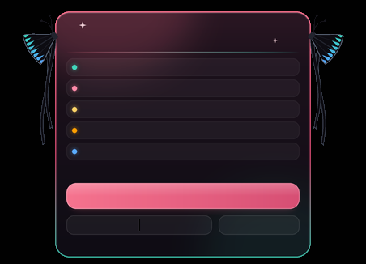

# Fish an Anime RNG (FAA) - Macro & Nino HUD Widget v4.0

AutoHotkey v2 macro for the Roblox game **Fish an Anime RNG**. A single version runs on any screen (desktop, laptop, any resolution): you record your own buttons once, in game.

## 🚀 Quick start

1. Double-click `START_MACRO.bat` (it installs AutoHotkey v2 for you if it is missing).
2. On first launch the **Setup** window opens. Click **▶ Record everything** and follow the instructions shown in the top-left corner of Roblox:
   * aim at the requested button with your mouse, then press **ENTER** (nothing gets clicked while you aim),
   * **↓ / ↑** scroll the shop (the macro scrolls exactly the same way when farming),
   * **BACKSPACE** skips an item, **ESC** cancels.
3. Press **F1** (or click **▶ START**).

Each part can be re-recorded at any time with **⚙ SETUP** or **F4**.

## 🌟 Features

* **🛒 Boost shop & 🌙 Selene's shop**: buys the potions you choose, right after each restock (:00, :05… / Selene every 30 min). If a timer tick is missed, the purchase still triggers during the next seconds of the window.
* **🟢 Fishing watchdog**: every 5 s it checks the fishing bar. If the character stopped fishing (God / Omniscient catch…), it clicks the green **Click to Fish!** button (only when its recorded green colour is really there, because the grey **Fishing.** button that stops fishing sits at the same spot). If Auto Fish turned grey, it turns it back on. Nothing is clicked after a shop or a rebirth: the character keeps fishing while a shop is open.
* **♻ Robux-safe auto-rebirth**: every 60 min or on **F9**, only ever clicks the green cash button.
* **🎃 Hallows Eve OCR**: detects the event banner and holds the event character (slot 2).
* **⚡ Rod ability**: presses **V** every 8 min 01 s.
* **🦋 Nino HUD**: draggable widget (its position is remembered). It becomes click-through while the macro clicks, so it never hides a game button.

## ⌨️ Hotkeys

| Key | Action |
| :--- | :--- |
| **F1** | Start / Pause |
| **F2** | Quit |
| **F3** | Shop clock offset (seconds) |
| **F4** | Setup window |
| **F5** | Run the shop now (test) |
| **F6** | Test the Hallows Eve OCR |
| **F7** | Draw the event banner zone |
| **F8** | Re-record the water spot |
| **F9** | Rebirth now |

## ⚙️ Configuration

`config.ini` is created from `config.example.ini` on first launch. Recorded positions go into its `[Routine]` section (ratios of the Roblox window, so they survive window resizing). Set potions to `1` (buy) or `0` (skip).

To regenerate the widget artwork: `python generate_assets.py` (Pillow + NumPy).

## 📜 Credits & License

* **Developer:** Kitsoune (Roblox: `Kitsouwune`) · **KITS Progress Inc.**
* [MIT License](LICENSE)
